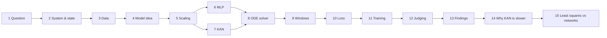

# The whole project, step by step

From the question to the answer, in the order it happens. Every step ends with the reason the next one is needed.
Numbers in steps 13–15 are from my own runs (`results/`, machine in `results/system_info.txt`).



| step | in one line | code |
|---|---|---|
| 1 Question | find µ of Van der Pol from noisy measurements | – |
| 2 System | x′ = v, v′ = µ(1 − x²)v − x | `vdp/system.py` |
| 3 Data | exact solution → 100 points → noise | `vdp/data.py` |
| 4–7 Model | network(state) = rate, physics loss with trainable µ; MLP or KAN | `vdp/networks.py` |
| 8–11 Training | dopri5, shooting windows, 3-part loss, Adam + L-BFGS | `vdp/neural_ode.py` |
| 12 Judging | error, success rule, failure types | `vdp/evaluate.py` |
| 15 Baseline | classical least squares | `vdp/least_squares.py` |

---

## 1. The question
We measure an oscillator with noise. We know its equation except one number, µ. Can we find µ from the noisy data?
We make the data ourselves with a known µ (1.5), hide it, and check each method. Kumar did this once with an MLP: 1.67 % error.
We repeat it with 50 seeds, three methods (least squares, MLP, KAN) and more settings.

**→ next:** to make data, we need the equation and its state.

## 2. The system and its state
Van der Pol: `x″ − µ(1 − x²)x′ + x = 0`. Near the centre (|x| < 1) the middle term pushes, far out it brakes,
so every start ends on the same loop (limit cycle). µ sets how strong this is.

Order reduction (on paper, once): name the velocity `v = x′`:

```
x′ = v
v′ = µ(1 − x²)v − x
```

- **State** `(x, v)`: position and velocity; fixes the whole future.
- **Rate** `(x′, v′)`: velocity and acceleration. Example at (2, 0), µ = 1.5: rate = (0, −2).

**→ next:** with µ and a start, the equation gives the exact motion: that is how we make data.

## 3. Making the data
| what | value |
|---|---|
| true µ / start / time | 1.5 / (2, 0) / 0 to 10 (Kumar) |
| exact solution | SciPy DOP853, tolerance 1e-10 |
| samples | 100 equally spaced |
| noise | Gaussian σ = 0.1 on x and v (also 0.01 and 0.3) |
| seed | built from (µ, σ, points, start, run): same data on every PC |

All 100 points train; the test is whether the learned µ matches the true one. Every setting gets new data and a new model.

**→ next:** a model that explains the dots and contains µ.

## 4. The model idea: physics-informed Neural ODE
```
state → network → rate → ODE solver → trajectory → compare with dots      (data loss)
                   └──→ compare with x′ = v, v′ = µ(1 − x²)v − x          (physics loss, µ trainable)
```
Neural ODE (Chen 2018): the network is the rule. Physics-informed (Raissi 2019): penalise disagreement with the known
equation. µ appears only in that penalty; the µ that makes network and formula agree is the answer.

**→ next:** the state is rescaled before the network.

## 5. Input scaling: ÷ 2.5
Inputs sit near −1…1 (at µ 1.5: x within ±2.0, v within ±3.3). tanh works best near 0; the KAN's spline grid only
covers −2.2…2.2. At µ = 4 the velocity reaches 6.3, so we divide by 6.5 there.

**→ next:** the scaled state goes into one of two networks.

## 6. Network A: the MLP (2 → 32 → 32 → 2)
- **learned:** one weight per wire + one bias per neuron
- **fixed curve:** tanh in every hidden node, `tanh(s) = (eˢ − e⁻ˢ)/(eˢ + e⁻ˢ)`, range −1…1, smooth; no tanh on the output
- **node:** `output = tanh(w₁·in₁ + w₂·in₂ + … + b)`

| layer | wires | biases | numbers |
|---|---|---|---|
| 2 → 32 | 64 | 32 | 96 |
| 32 → 32 | 1,024 | 32 | 1,056 |
| 32 → 2 | 64 | 2 | 66 |
| **total** | | | **1,218** |

Width 32 is our choice (Kumar gives none). A 16-wide MLP (354 weights) gave the same accuracy (1.23 % vs 1.13 %).

**→ next:** the KAN does the same job with a different inside.

## 7. Network B: the KAN (2 → 10 → 2)
- **learned:** one curve per wire; 2·10 + 10·2 = 40 wires
- **fixed curve:** SiLU base on every wire, `SiLU(u) = u/(1 + e⁻ᵘ)`; nodes only add (no tanh, no bias)
- **idea:** Kolmogorov–Arnold theorem (Liu et al. 2024); code: official efficient-kan

A **spline** = smooth bumps (B-splines) × learned heights, added up. Grid 5 pieces on −1…1 + cubic order 3
→ 5 + 3 = **8 bumps** per curve.

```
φ(u) = w_base · SiLU(u) + w_scale · (c₁B₁(u) + … + c₈B₈(u))
per wire: 8 heights + 1 base weight + 1 scale = 10   →   40 wires × 10 = 400
```

Not ~250: counting 5 grid pieces + 1 per curve gives 40 × 6 = 240, missing the 3 cubic bumps and the 2 extra numbers.
(Original pykan reports 560 = the same 400 + 160 for a switched-off symbolic branch.)

**→ next:** either network gives a rate; the solver turns rates into motion.

## 8. The ODE solver
`new state = state + rate × Δt`, repeated (Euler, the simplest version). We use torchdiffeq's **dopri5**: about 6 rate
calls per step, adaptive step size, error < 1e-3. PyTorch traces gradients back through every step.

**→ next:** one long run trained badly, so time is split into windows.

## 9. Multiple shooting (windows)
One run from t = 0 to 10 lets early errors grow (µ came out 0.25). Kumar's fix: cut time into windows, each with its own
trainable start state (initialised at its first data point); a continuity loss joins them.
10 windows of 10 points at Kumar's setting; 50 windows of 2 points elsewhere (needed for µ = 4).

**→ next:** one number for how wrong the predictions are.

## 10. The loss
```
loss = data + continuity + 1 × physics
```
- data: mean (predicted − measured)²
- continuity: mean (window end − next window start)²
- physics: mean (network rate − formula rate with current µ)²; the only place µ appears

**→ next:** training changes every trainable number to shrink it.

## 11. Training
Trainable: network weights (1,218 or 400), µ (starts at 1.0), window starts (20 or 100).
Each step: solve all windows → loss → gradients (backpropagation) → nudge.
Adam 1,500 steps (step size 0.01), then L-BFGS 300 iterations (Raissi's recipe).
On my PC µ first dips (MLP to 0.13) while the network learns the shape, then climbs to ~1.5.
CPU, float64, 1 thread per run, 19 runs in parallel.

**→ next:** judge the learned µ.

## 12. Judging
`error = |learned µ − true µ| / true µ`. **Success** = error ≤ 10 % and data error ≤ 2σ².
Failures: no fit / wrong µ / crash. Every setting repeated with 20–50 seeds.

**→ next:** change one thing at a time and repeat.

## 13. Findings (my PC)
| setting | least squares | MLP | KAN |
|---|---|---|---|
| Kumar's setting, 50 seeds | 50/50 · 0.38 % | 50/50 · 1.13 % | 50/50 · 0.99 % |
| µ 1.5, σ 0.3 | 50/50 · 1.2 % | 43/50 · 5.0 % | 42/50 · 5.3 % |
| µ 4, σ 0.1 | 38/50 · 0.06 % | 46/50 · 1.5 % | 38/50 · 2.4 % |
| µ 4, σ 0.3 | 32/50 · 0.50 % | 45/50 · 3.9 % | 29/50 · 7.9 % |
| µ 4, 50 points | 13/20 | 8/20 | 0/20 |
| Duffing, σ 0.1 | 20/20 | 12/20 | 20/20 |

Full tables: [`RESULTS.md`](../RESULTS.md).

**→ next:** the KAN is as accurate but slower. Why?

## 14. Why the KAN is slower with fewer weights
Speed depends on the work per call, not on the number of weights. An MLP call is 3 matrix multiplications (what
computers do fastest). A KAN call computes, for each input on each wire, its grid piece, 8 spline bumps and SiLU.
The solver calls the network ~14 times per training step, ~25,000 times per run (counted on a test machine).
On my PC: 30 s (MLP) vs 95 s (KAN) per run at Kumar's setting. The KAN authors report ~10× slower training than an
MLP of equal size.

**→ next:** does a network beat the classical method at all?

## 15. Least squares vs. the networks: the answer
Least squares: guess µ and the start, simulate, compare, adjust (SciPy `least_squares`); 3 unknowns, no network.

- **Equation fully known:** least squares is the most accurate and ~100× faster.
- **Hard, jumpy motion (µ = 4):** least squares, started from µ = 1.0, can lock onto a wrong answer (worst 177 % off);
  the MLP with short windows was the most reliable.
- **MLP vs KAN:** equal on Van der Pol up to µ 1.5, KAN ~3× slower; on Duffing the KAN clearly beats the MLP.
- **Harder for every method:** more noise, small µ, few points.
- **Next:** problems where part of the equation is unknown, where only the networks can help.

## Animations
Short clips (run 0, Kumar's setting), in the order of the map:
[system](animations/1_system.mp4) ·
[sampling](animations/2_sampling.mp4) ·
[MLP](animations/3_mlp.mp4) ·
[KAN](animations/4_kan.mp4) ·
[arrow map](animations/5_arrow_map.mp4) ·
[ODE solver](animations/6_ode_solver.mp4) ·
[training](animations/7_training.mp4) ·
[result](animations/8_result.mp4).
Source and re-render script: [animations/source](animations/source/README.md).
